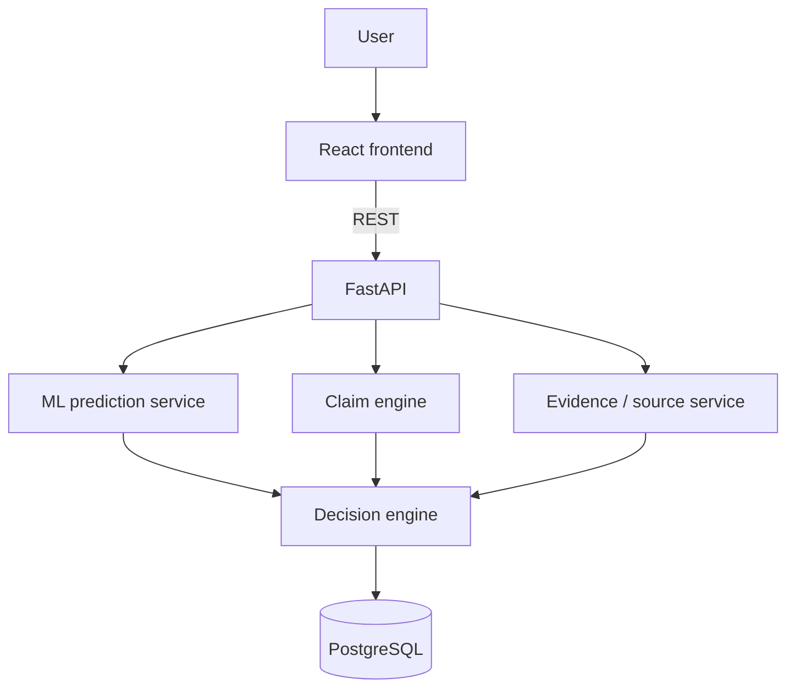

# Veritas — AI-powered fake news detection and verification

Veritas is a modular verification assistant: a user pastes a headline and article (or an optional URL), a FastAPI service runs NLP classification plus claim/evidence layers, and a React UI presents a **likely real / likely fake / uncertain** assessment with confidence, explanations, and limitations.

This is an AI-generated **probabilistic assessment**, not proof that a story is true or false.

## Problem

Automated “fake news” labels are easy to over-claim. Style-based classifiers confuse satire, opinion, and breaking news. This project treats detection as a **decision-support** product: thresholds, explanations, evidence interfaces, and explicit limitations.

## Features

- Paste headline + article, or attempt URL extraction with SSRF protections
- Batch and CSV multi-article verification mode
- Dynamic model selection: Classical TF-IDF models (LR, Naive Bayes, SVM, Random Forest) and DistilBERT fine-tuned sequence transformer
- Three-class calibrated decision layer (`LIKELY_REAL`, `LIKELY_FAKE`, `UNCERTAIN`)
- In-text stylistic token attribution heatmaps with directional polarity filters
- Proposition extraction for discrete empirical assertions
- Multi-provider evidence retrieval: Google Fact Check Tools API, live public web search feeds, NewsAPI, and offline mock index
- Source domain category tagging (`ESTABLISHED_NEWS`, `OFFICIAL`, `RESEARCH_ORGANIZATION`, `SUSPICIOUS`, `UNKNOWN`)
- User authentication & multi-tenancy (JWT tokens, private analysis history, user-scoped dashboard)
- Dark Mode and Light Mode theme switcher
- PostgreSQL/SQLite history, Recharts dashboard visualizations, Docker Compose, and GitHub Actions CI

## Architecture



## Technology stack

Python 3.11, FastAPI, SQLAlchemy, scikit-learn, optional PyTorch/Transformers, React, Vite, TypeScript, Tailwind CSS, Recharts, PostgreSQL, Docker.

## Dataset

Default training uses `ml/data/raw/sample_articles.csv`, a **synthetic demo corpus** documented in `ml/data/DATASETS.md`. Labels mean “straight-news style” vs “sensational fabricated style”, **not** LIAR/FakeNewsNet definitions.

Do not advertise metrics from this corpus as real-world misinformation performance. Plug in a licensed third-party set before research claims.

## Installation

```bash
cd fake-news-verification
python -m venv .venv
# Windows: .venv\Scripts\activate
# Unix: source .venv/bin/activate
pip install -r backend/requirements.txt
copy .env.example .env   # or cp
python -m ml.preprocessing.generate_sample
python -m ml.training.train_classical
```

Frontend:

```bash
cd frontend
npm install
```

## Environment variables

See `.env.example`. Never commit `.env`. Never put API keys in the React app.

## Running locally

Terminal 1 (from repo root):

```bash
set PYTHONPATH=backend;.
uvicorn app.main:app --reload --app-dir backend
```

PowerShell:

```powershell
$env:PYTHONPATH = "backend;."
uvicorn app.main:app --reload --app-dir backend
```

Terminal 2:

```bash
cd frontend
npm run dev
```

Open http://localhost:5173. API docs: http://localhost:8000/docs

SQLite is the default if `DATABASE_URL` is unset. For PostgreSQL, start Compose Postgres and set `DATABASE_URL` as in `.env.example`.

## Docker

```bash
python -m ml.preprocessing.generate_sample
python -m ml.training.train_classical
docker compose up --build
```

App: http://localhost:8080  API: http://localhost:8000

## Testing

```bash
pytest
cd frontend && npm test
```

## Optional DistilBERT

```bash
pip install -r backend/requirements-ml.txt
python -m ml.training.train_distilbert
```

Production inference automatically detects and serves the fine-tuned DistilBERT model when present in `models/distilbert`, with graceful fallback to the classical TF-IDF model. You can also select the engine explicitly in the API or UI.

## Deployment

- Frontend: static build on Vercel (`frontend/`, `VITE_API_URL` pointing at the API)
- Backend: Render/Railway/AWS running `uvicorn app.main:app`
- Database: managed PostgreSQL or Supabase
- Do not bake hostnames into code; use environment variables

## Limitations

Documented in `docs/limitations.md`. Confidence is classification confidence, not objective falsehood probability. Lack of search hits is not proof of falsity.

## License

MIT
