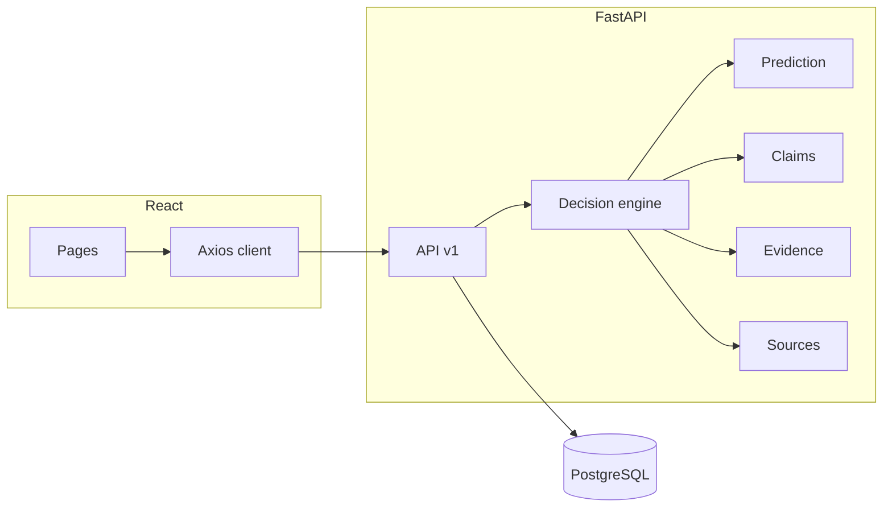

# Architecture

The system is split into frontend, API, ML inference, claim/evidence services, and persistence.

## Layers

| Layer | Location | Responsibility |
| --- | --- | --- |
| UI | `frontend/src` | Capture input, render assessments, charts |
| HTTP API | `backend/app/api` | Validation, status codes, OpenAPI |
| Decision | `backend/app/services/decision.py` | Combine model + claims + evidence |
| ML | `ml/` | Train, evaluate, explain, infer |
| DB | `backend/app/database` | Analyses, claims, evidence, model versions |

Optional services (URL fetch, NewsAPI, LIME) are isolated. If they fail, classification still returns.
