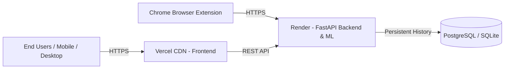

# Veritas — Complete Free Cloud Deployment Guide

This guide walks through deploying the **Veritas** web application and backend API to 100% free, 24/7 permanent cloud hosting.

---

## Architecture Overview



---

## Part 1: Deploy Backend API to Render (Free)

1. Push your repository to your **GitHub** account.
2. Sign up / Log in to [Render](https://render.com).
3. Click **"New +"** → Select **"Web Service"**.
4. Connect your GitHub repository `fake-news-verification`.
5. Configure settings:
   - **Name**: `veritas-api`
   - **Environment**: `Python 3`
   - **Region**: Any (e.g., Oregon / Frankfurt)
   - **Branch**: `main` (or `master`)
   - **Build Command**:
     ```bash
     pip install -r backend/requirements.txt && python -m ml.preprocessing.generate_sample && python -m ml.training.train_classical
     ```
   - **Start Command**:
     ```bash
     uvicorn app.main:app --host 0.0.0.0 --port $PORT --app-dir backend
     ```
   - **Instance Type**: `Free`
6. Add Environment Variables:
   - `PYTHONPATH`: `backend:.`
   - `APP_ENV`: `production`
   - `BACKEND_CORS_ORIGINS`: `*`
   - `JWT_SECRET`: *(Generate any random string)*
7. Click **"Create Web Service"**.
   - Your live backend API will be online at: `https://veritas-api-xxxx.onrender.com`.

---

## Part 2: Deploy Frontend to Vercel (Free)

1. Sign up / Log in to [Vercel](https://vercel.com).
2. Click **"Add New..."** → Select **"Project"**.
3. Import your GitHub repository `fake-news-verification`.
4. Configure project settings:
   - **Framework Preset**: `Vite`
   - **Root Directory**: Click edit and choose `frontend`.
   - **Build Command**: `npm run build`
   - **Output Directory**: `dist`
5. Add Environment Variable:
   - **Name**: `VITE_API_URL`
   - **Value**: `https://veritas-api-xxxx.onrender.com/api/v1` *(Your Render backend URL from Part 1)*
6. Click **"Deploy"**.
   - Your frontend will be live worldwide at: `https://your-veritas-app.vercel.app`!

---

## Part 3: Connect Chrome Extension to Live Cloud

1. Click the **Veritas Shield icon** in your browser toolbar.
2. Click the **⚙️ (Settings)** icon in the top right.
3. Update:
   - **Backend API URL**: `https://veritas-api-xxxx.onrender.com/api/v1`
   - **Web Dashboard URL**: `https://your-veritas-app.vercel.app`
4. Click **Save**.
5. Your browser extension will now verify web pages and highlighted text globally using your live cloud backend.
