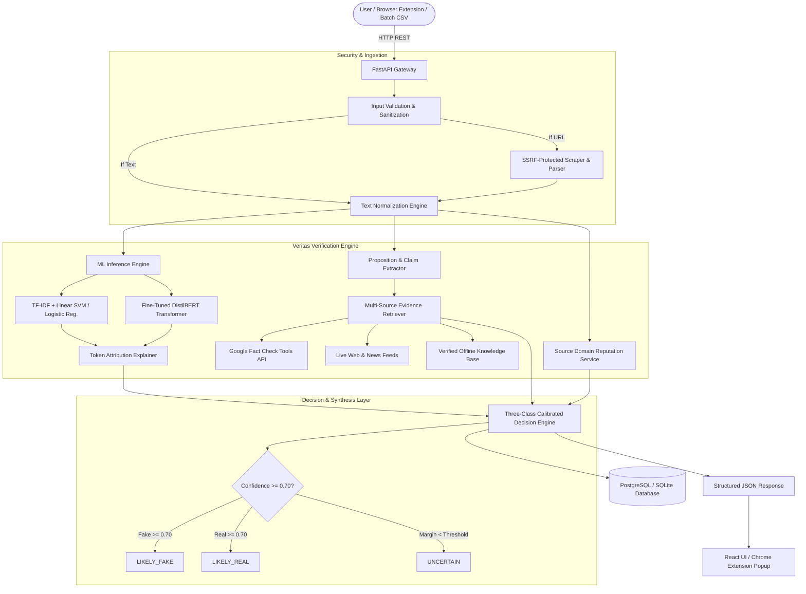

# Veritas: AI-Powered Fake News Detection & Verification Platform
## Comprehensive Presentation & Project Defense Guide

> **Note:** A duplicate copy is maintained at the root of the repository as [`PROJECT_PRESENTATION.md`](file:///d:/fake-news-verification/PROJECT_PRESENTATION.md).

---

# Slide 1: Title & Project Overview

### Project Title
**Veritas — AI-Powered Fake News Detection and Verification Assistant**

### Tagline
*A Multi-Layered Epistemic Decision-Support System for Misinformation Analysis and Evidence Corroboration.*

### System Requirements & Environment
* **Backend Runtime:** Python 3.10 / 3.11+ (FastAPI, Uvicorn, SQLAlchemy 2.0, Pydantic v2)
* **Machine Learning & NLP:** scikit-learn, NumPy, SciPy, PyTorch, Hugging Face Transformers (`distilbert-base-uncased`)
* **Frontend Web Application:** React 18, TypeScript, Vite, Tailwind CSS, Recharts, Lucide Icons
* **Browser Extension:** Google Chrome / Chromium Manifest V3 WebExtension API
* **Data Storage:** SQLite 3 (Development / Offline) / PostgreSQL 15+ (Production)
* **Containerization & CI/CD:** Docker, Docker Compose, GitHub Actions CI
* **Minimum System Specs:** 8 GB RAM (16 GB for PyTorch Transformer inference), Dual-Core 2.5 GHz+ CPU

---

# Slide 2: Problem Statement & Objectives

### The Problem
* **Overconfidence of Binary Classifiers:** Traditional models output simple "Real" vs. "Fake" labels without justification, often misclassifying satire, breaking news, and opinion pieces.
* **Lack of Evidence Corroboration:** Most detectors examine only surface writing style (word frequencies) rather than verifying whether the claims match real-world facts.
* **Black-Box Opacity:** Users cannot see *why* an AI flagged a story, leading to lack of trust or blind acceptance.

### Core Objectives
1. **Move from "Proof" to Decision Support:** Provide calibrated probabilistic assessments (`LIKELY_REAL`, `LIKELY_FAKE`, `UNCERTAIN`) rather than claiming absolute truth.
2. **Dual-Track Verification Pipeline:**
   * **Track 1 (Stylistic NLP):** Evaluate lexical markers and rhetorical patterns using calibrated TF-IDF and fine-tuned DistilBERT models.
   * **Track 2 (Empirical Corroboration):** Extract discrete factual claims and cross-reference them against authoritative knowledge bases and live fact-check registries.
3. **Explainable AI (XAI):** Generate token-level attribution heatmaps that visually show which specific words pushed the prediction toward "Fake" or "Real".
4. **End-to-End Multi-Interface Accessibility:** Deliver the system as a responsive Web Application, REST API, Batch CSV processor, and an instant In-Browser Extension.

---

# Slide 3: System Architecture



---

# Slide 4: Data Structures Used

| Data Structure | Implementation Context | Engineering Purpose & Complexity |
| :--- | :--- | :--- |
| **Compressed Sparse Row Matrix (`csr_matrix`)** | `scipy.sparse.csr_matrix` in `ml/preprocessing` & `ml/inference` | Represents high-dimensional TF-IDF vectors ($N \text{ articles} \times 10,000 \text{ vocabulary terms}$) with $O(K)$ space efficiency, avoiding memory exhaustion from zero-valued elements. |
| **Hash Tables / Dictionaries (`dict`)** | `sources.py`, `prediction.py`, LRU Caches | $O(1)$ constant-time lookup for domain authority classifications (`ESTABLISHED_NEWS`, `OFFICIAL`, `RESEARCH_ORGANIZATION`, `SUSPICIOUS`, `UNKNOWN`) and in-memory caching of loaded models. |
| **Hash Sets (`set`)** | `claims.py` & `decision.py` | Guarantees $O(1)$ deduplication of repetitive extracted sentences, duplicate URLs, and identical citations from external search results. |
| **Argmax / Ranked Heaps (`argsort`)** | `ml/explainability/attribution.py` | Extracts the top-$K$ most influential tokens via $O(V \log K)$ sorting over coefficient-weight products ($\text{TF-IDF} \times \text{weights}$). |
| **Relational Hierarchical Trees (ORM)** | SQLAlchemy Models (`session.py`) | Models 1-to-Many relational cascades: `User` $\rightarrow$ `Analysis` $\rightarrow$ `Claim` $\rightarrow$ `Evidence`, preserving foreign key integrity and audit trails. |
| **Strict Type Hierarchies (Pydantic / TS)** | `schemas/analysis.py` & `frontend/src/types` | Tree-structured data contracts for serialization, request validation, and strict end-to-end type safety between Python backend and TypeScript UI. |

---

# Slide 5: Working & Implementation Details

### 1. Ingestion & SSRF Protection
* Accepts pasted headline and article text or extracts content from a URL.
* Protects against **Server-Side Request Forgery (SSRF)**: validates target IPs, blocking private/internal network ranges (`127.0.0.1`, `10.0.0.0/8`, `192.168.0.0/16`, AWS/GCP metadata endpoints).

### 2. Dual-Track Machine Learning Engine
* **Classical Engine:** Unigram + Bigram TF-IDF vectorizer coupled with a calibrated Linear Support Vector Classifier (and Logistic Regression fallback).
* **Transformer Engine:** PyTorch implementation utilizing `DistilBERT-base-uncased` fine-tuned for semantic style classification.
* **Adaptive Routing:** The system auto-detects GPU/Transformer availability and falls back gracefully to classical TF-IDF inference.

### 3. Explainable AI (XAI) Attribution
* Direct mathematical attribution for linear models:
  $$\text{Contribution}(token_i) = \text{TF-IDF}(token_i) \times \text{Weight}_i$$
* Positive weights signal sensationalism/disinformation markers; negative weights indicate standard journalistic tone.
* Renders interactive, color-coded highlight heatmaps directly on the user's screen.

### 4. Proposition & Claim Extraction
* Employs regular expressions, reporting verbs (*stated, confirmed, banned, announced*), and quantitative numerical extractors (*percentages, currency, casualty figures*) to isolate empirical statements from rhetorical narrative.
* Computes propositional importance scores ($0.25 \le w \le 0.98$) to prioritize claims requiring fact-checking.

### 5. Multi-Source Evidence Retrieval & Stance Analysis
* Integrates **Google Fact Check Tools API**, live web search feeds, and an offline baseline verification index.
* Performs lexical stance detection to determine whether authoritative citations **Support**, **Contradict**, or are **Inconclusive** regarding the claim.

### 6. Epistemic Calibration & Limitations
* Thresholds are applied: $P(\text{fake}) \ge 0.70 \rightarrow \text{LIKELY\_FAKE}$; $P(\text{real}) \ge 0.70 \rightarrow \text{LIKELY\_REAL}$; otherwise $\rightarrow \text{UNCERTAIN}$.
* Every report attaches explicit epistemic limitations (e.g., *"Model confidence is not proof of factual truth; breaking news may lack historical corroboration"*).

---

# Slide 6: Output & Demonstration Scenarios

### Verification Output Format

```json
{
  "prediction": "LIKELY_FAKE",
  "confidence": 0.942,
  "model_version": "classical_tfidf_v1",
  "backend": "sklearn_tfidf",
  "claims": [
    {
      "text": "A secret ancient root discovered deep in the jungle completely eradicates all malignant tumors overnight.",
      "importance": 0.85,
      "assessment": "potentially_unsupported",
      "evidence": [
        {
          "source_name": "National Cancer Institute Fact Check",
          "url": "https://www.cancer.gov/about-cancer/treatment/clinical-trials/debunked",
          "title": "Clinical oncology consensus: No ancient root eradicates terminal cancer in 24 hours",
          "stance": "contradicts",
          "relevance_score": 0.92
        }
      ]
    }
  ],
  "explanation": [
    {"token": "secret", "score": 0.28, "direction": "fake", "influence": "high"},
    {"token": "miracle", "score": 0.22, "direction": "fake", "influence": "high"},
    {"token": "banned", "score": 0.18, "direction": "fake", "influence": "medium"}
  ],
  "source_analysis": {
    "domain": "unverified-rumor.com",
    "category": "UNKNOWN"
  },
  "narrative": "The system assesses this article as likely fake based on model prediction and available evidence.",
  "limitations": [
    "This result is an AI-generated probabilistic assessment, not proof that an article is true or false.",
    "Truth cannot always be inferred from writing style."
  ]
}
```

### UI Features in the Demo
1. **Analyze View:** Text paste area, URL reader, model selector (`Auto`, `Classical`, `DistilBERT`), and multi-article CSV batch analyzer.
2. **Assessment Card:** Color-coded status badge (`Green: LIKELY_REAL`, `Red: LIKELY_FAKE`, `Amber: UNCERTAIN`) with confidence dial.
3. **Interactive Attribution Heatmap:** Direct in-text highlight badges indicating tokens that influenced the score.
4. **Claim & Evidence Accordion:** Expandable panels detailing extracted claims alongside direct URLs and stance tags (*Supports / Contradicts*).
5. **Analytics Dashboard:** Visual charts powered by Recharts tracking user analysis volume, prediction distributions, and average confidence scores.
6. **Chrome Extension Popup:** Single-click browser companion that extracts the active page text and delivers instant verification results.

---

# Slide 7: Conclusion & Real-World Applications

### Key Achievements
* Successfully constructed a modular, transparent fake news verification pipeline that combines machine learning with empirical fact-checking.
* Solved the "black box" critique by providing interactive token heatmaps and explicit limitations.
* Provided production-ready deployment assets: RESTful endpoints, Docker containers, database migrations, and client extensions.

### Real-World Applications
* **Journalism & Fact-Checking Desks:** Acts as an automated first-pass screening tool for newsrooms handling large volumes of user tips and syndicated stories.
* **Social Media & Content Platforms:** Powers triage moderation queues, routing high-risk content to human reviewers while mitigating false positives with the `UNCERTAIN` classification.
* **Consumer Web Extension:** Protects everyday internet users from viral hoaxes, financial scams, and deceptive medical remedies directly within their browser.
* **Media Literacy & Education:** Serves as a teaching instrument in academic institutions, helping students analyze sensationalism, source authority, and evidence trails.

---

### End of Presentation
**Project Repository:** `Veritas — fake-news-verification`  
**License:** MIT
